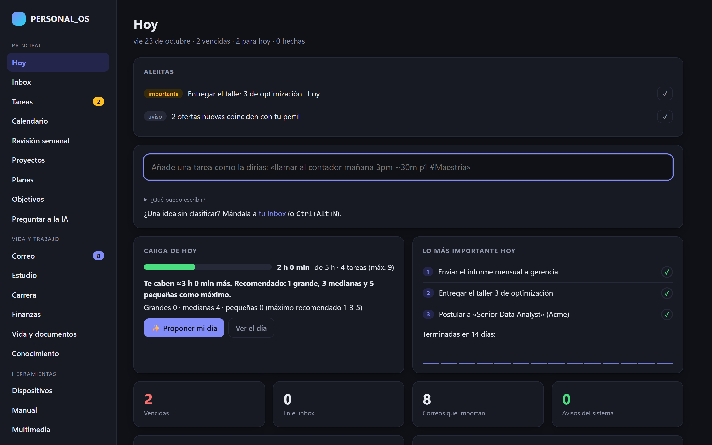
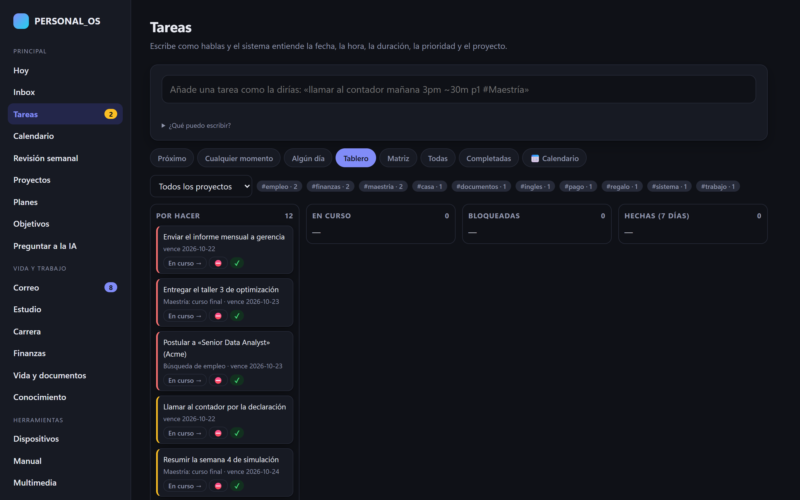
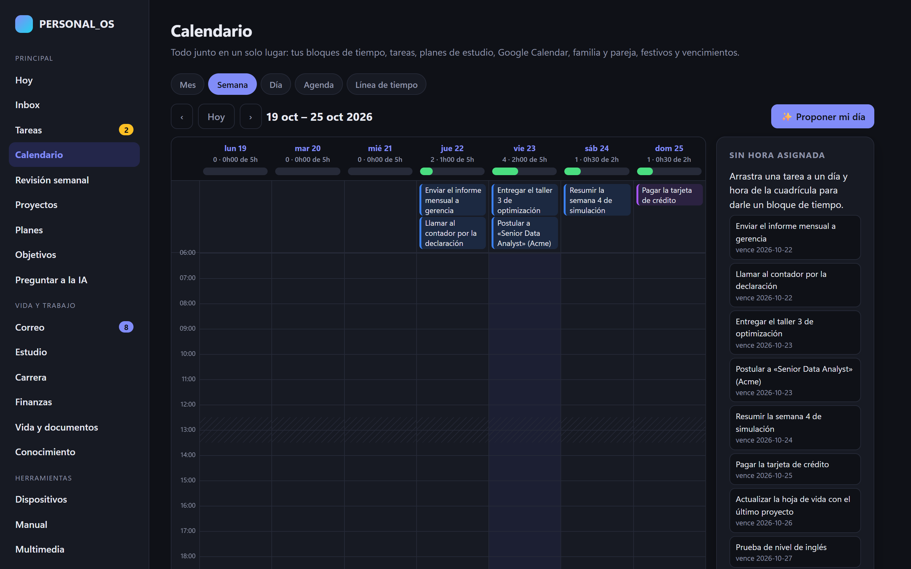
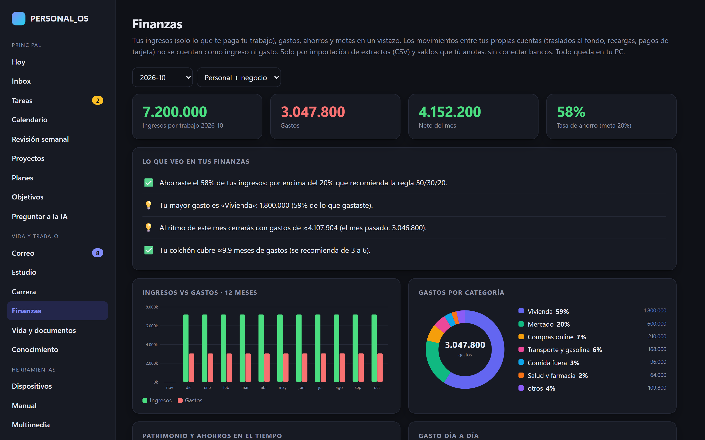
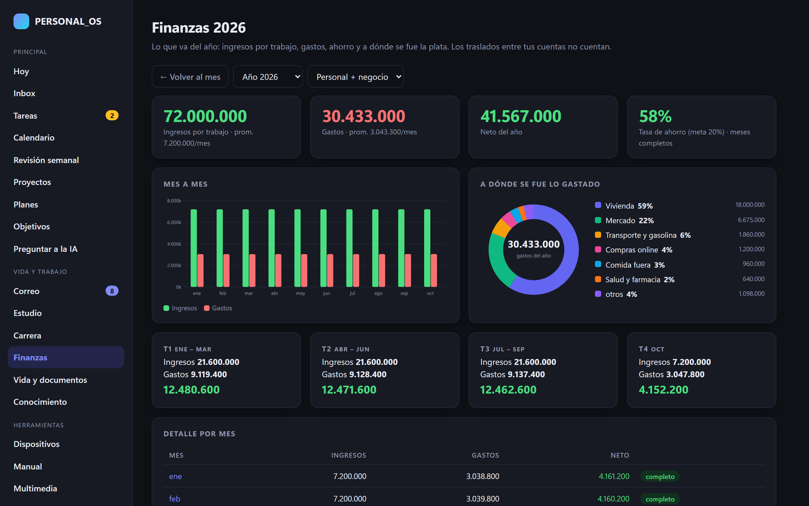
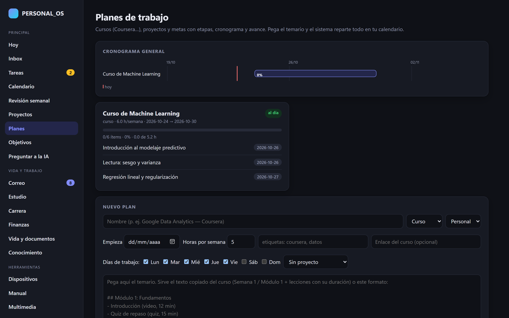
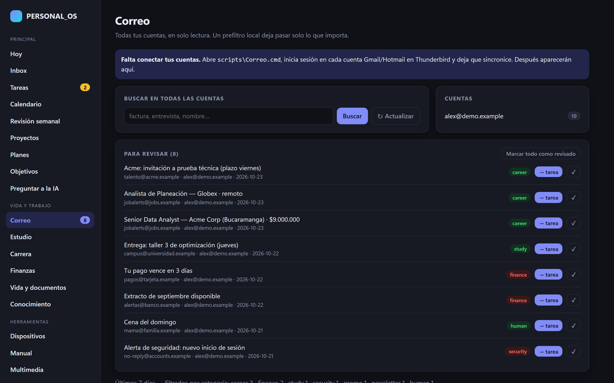
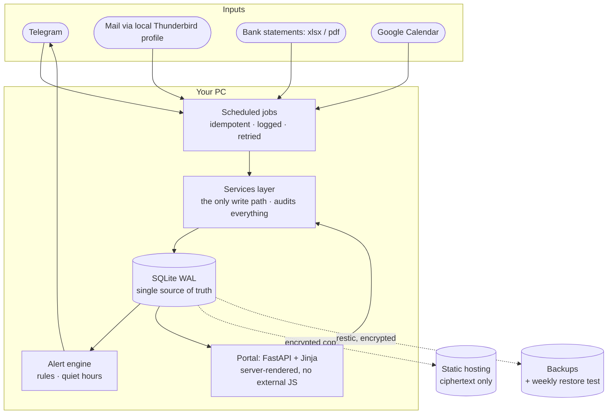

<div align="center">

# 🧭 PERSONAL_OS

### A local-first personal operating system: tasks, calendar, money, mail and study in one portal — deterministic first, AI only where it earns its place

Runs on your own PC (SQLite + FastAPI), notifies you on Telegram, backs itself up with encrypted snapshots, and shows you **only what needs your attention today**.


*🇪🇸 Un sistema operativo personal que corre en tu PC: tareas, calendario, finanzas, correo y estudio en un solo portal. Reglas deterministas primero; IA solo donde hace falta.*

<br>



</div>

---

## Why I built it

I was juggling a master's degree, a full-time analytics job, a job search and personal finances across a dozen apps, and most notifications went unread. PERSONAL_OS replaces that with **one place that decides what deserves my attention** — and does the repetitive work (importing bank statements, sorting mail, scheduling study plans, reminding me of expiries) without asking.

> **Design rule:** *same inputs → same outputs.* Everything that can be solved with rules, queries and scripts is; AI is reserved for ambiguous text and drafting, and its decisions are logged. Nothing external and irreversible (sending, paying, deleting) happens without an explicit approval.

## A tour (demo data — everything on screen is fictitious)

| | |
|---|---|
|  **Tasks** — natural-language quick-add, board, subtasks, recurrence, capacity-aware planning |  **Calendar** — tasks, plan items, family dates and holidays together |
|  **Finance** — statement import, rule-based categories, income only from work, transfers reconciled |  **Year view** — quarters, monthly bars, spending by category, net worth |
|  **Plans** — turn a syllabus into a day-by-day schedule |  **Mail** — classified by sender and header rules; only actionable items surface |

## What it does

- **Today, not "everything".** A daily load meter against your real capacity (1-3-5 rule) and the three things that matter most, with one-tap *done / tomorrow* buttons on Telegram.
- **Capture in one line.** `llamar al contador mañana 3pm ~30m p1 #Maestría` becomes a dated, estimated, prioritised, tagged task — parsed by rules, no model.
- **Finance without bank APIs.** Parsers for five statement formats (xlsx/pdf), deterministic categories, internal transfers and card payments excluded from income/expense, transfer pairs reconciled across accounts, monthly/yearly summaries and server-rendered SVG charts.
- **Mail triage by rules.** Sender/domain/header rules classify security, finance, study, career and promotions; the rest never competes for attention.
- **Expiry tracking that renews itself.** Documents (insurance, inspections, passports) spawn *prepare* tasks 30 days ahead and *do it* tasks 15 days ahead, and roll over a year when completed.
- **Plans from a syllabus.** Paste a course outline; get a schedule that respects your study days.
- **Alert engine with quiet hours.** ~12 rules, de-duplicated by key, pushed to Telegram only when they matter.
- **Safe by construction.** PIN with scrypt, signed sessions, rate limiting, DNS-rebinding guard, strict CSP (no external JS), device pairing with one-time links, encrypted restic backups with restore tests.
- **Read-only copy for when the PC is off.** The portal renders itself, encrypts it (AES-256-GCM) and publishes it to static hosting; the key travels only in the URL fragment of the pairing link and never reaches any server.

## Architecture



- **Single write path.** Every change goes through `services`, which writes an audit row — CLI, portal, Telegram and jobs all share it.
- **Auto-migrating schema.** `db._apply_schema` + `_add_column` heal old databases on first connect.
- **Jobs are idempotent.** Re-running any job never duplicates tasks, alerts or transactions (hash keys, `INSERT OR IGNORE`, meta markers).
- **Decisions are written down.** See [`docs/DECISIONS.md`](docs/DECISIONS.md) — every non-obvious choice, with the alternatives rejected.

## Try it in two minutes (fictitious data)

```bash
python -m venv .venv && .venv\Scripts\activate
pip install -r requirements-dev.txt
python scripts/demo_seed.py      # builds a demo database for "Alex Rivera"
python scripts/demo_portal.py    # http://127.0.0.1:8790  ·  PIN: demo-1234
python -m pytest -q scripts/tests
```

The demo uses an in-memory keyring and its own database: it never touches real credentials or data. `python scripts/demo_capturas.py` regenerates the screenshots above.

## Repository map

| Path | What it is |
|---|---|
| `scripts/pos/` | The engine: services, finance, statements, mail, planner, alerts, backup, Telegram, panel… (≈8.8k lines) |
| `portal/` | FastAPI app, Jinja templates, static assets, encrypted-viewer source |
| `automation/` | Windows Task Scheduler registration (jobs, portal, shortcuts) |
| `scripts/tests/` | 108 tests: parsers, rules, security, idempotency |
| `docs/` | Architecture, data model, jobs catalogue, security, backup/recovery, decision log |

## About this public version

This is a **showcase snapshot** of a system I use daily. Personal data, names, bank rules, hostnames and private documentation were removed or replaced, and the git history is fresh. It is Windows-first (Credential Manager, Task Scheduler) and documentation is mostly in Spanish, the language of the UI.

## Author

**Camilo Ruiz** — mechanical engineer & physicist (Universidad de los Andes), MSc in Analytics (MIAD) in progress. I build data and automation systems. → [github.com/camilo7100](https://github.com/camilo7100) · see also [ventabot-showcase](https://github.com/camilo7100/ventabot-showcase)

## License

MIT — see [LICENSE](LICENSE).
